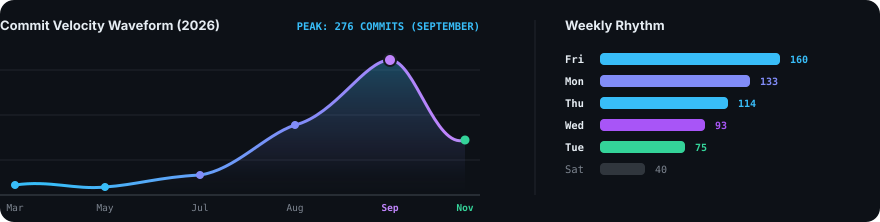
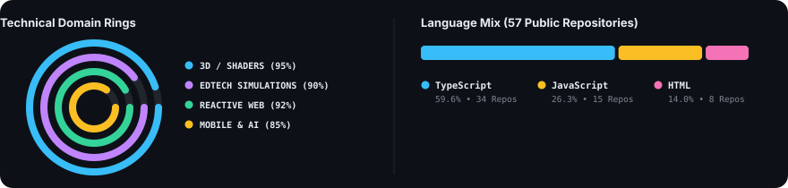
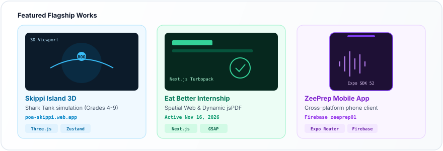

<!-- EDITORIAL IDENTITY HEADER -->

  

<!-- MARIO HERO ANIMATION -->

  

<!-- LIVE CURRENTLY BUILDING COMMIT TICKER -->

  

<!-- DEVELOPER XP & SPRINT STREAK BAR -->

  

<!-- MINIMALIST GOLD & SILVER ACHIEVEMENT TROPHIES -->

  

<!-- LONGER CONTRIBUTION SNAKE -->

  

<!-- ACTIVITY VELOCITY WAVEFORM & WEEKLY RHYTHM -->

  

<!-- CODING CADENCE & SOUND WAVEFORM -->

  

<!-- DOMAIN RINGS & VERIFIED LANGUAGES -->

  

<!-- CURATED FLAGSHIP PROJECTS -->

  

 

  

