

<!-- ═════════════ TITLE SCREEN ═════════════ -->
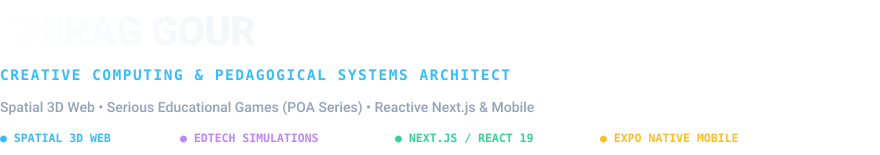

  

  

<!-- MAIN MENU — the cursor hops across the buttons; each one jumps to its stage -->
<a href="#player"></a>
<a href="#skills"></a>
<a href="#levels"></a>
<a href="#scores"></a>
<a href="#arcade"></a>
<a href="#continue"></a>

  

<!-- ═════════════ STAGE 01 · PLAYER SELECT ═════════════ -->


 

<a href="https://chirag-gour.github.io/CHIRAG-GOUR/"></a>

  


  

   

<!-- ═════════════ STAGE 02 · SKILL TREE ═════════════ -->


 

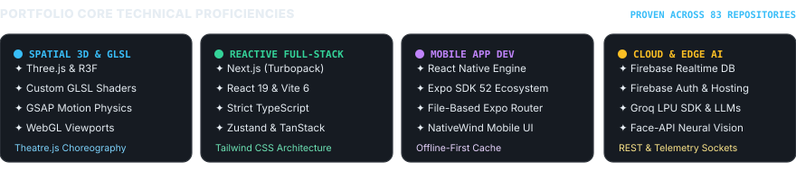

  

   

<!-- ═════════════ STAGE 03 · LEVEL SELECT ═════════════ -->


 

<a href="https://github.com/CHIRAG-GOUR/ZeePrep-MobileApp">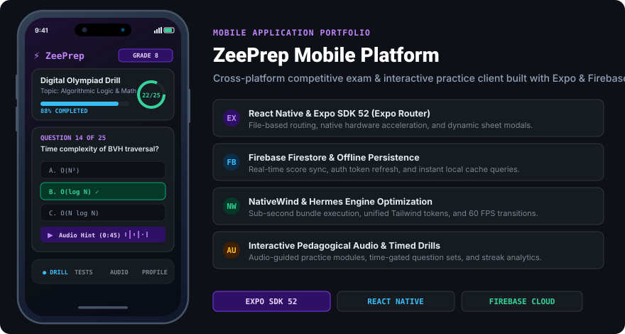</a>

  

<a href="https://podcast-tool-new.vercel.app">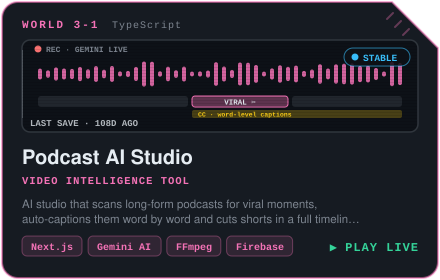</a>
<a href="https://github.com/CHIRAG-GOUR/SaltyRevamp">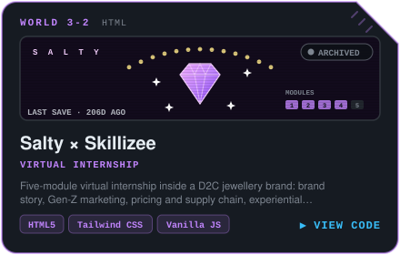</a>
 
<a href="https://github.com/CHIRAG-GOUR/Eat-Better-Internship">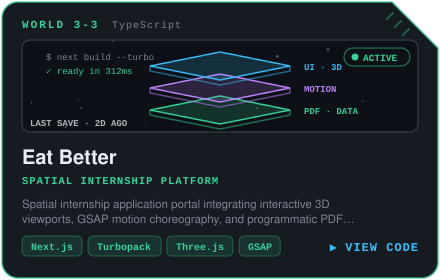</a>
<a href="https://olympiad-activities.web.app">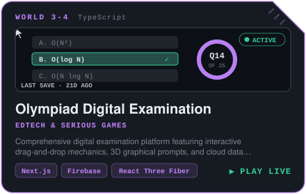</a>
 
<a href="https://github.com/CHIRAG-GOUR/Mangalyan-India">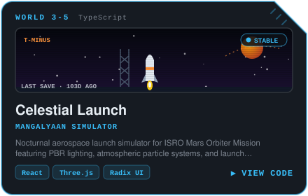</a>
<a href="https://github.com/CHIRAG-GOUR/SolarSystem3js"></a>

  

   

<!-- ═════════════ STAGE 04 · HIGH SCORES ═════════════ -->


 

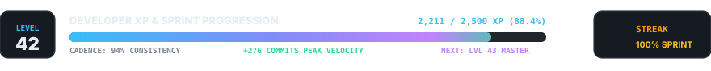

  

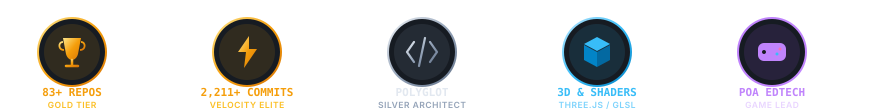

   

<!-- ═════════════ STAGE 05 · BONUS ARCADE ═════════════ -->


 

<a href="https://chirag-gour.github.io/CHIRAG-GOUR/?mode=snake"></a>

  

<a href="https://chirag-gour.github.io/CHIRAG-GOUR/?mode=space"></a>

  


  


  

  

  

&nbsp;

&nbsp;

&nbsp;

   

<!-- ═════════════ STAGE 06 · CONTINUE? ═════════════ -->


 

<a href="https://github.com/CHIRAG-GOUR/CHIRAG-GOUR/issues/new?title=%F0%9F%AA%99%20insert%20coin&body=Just%20press%20%2A%2ASubmit%20new%20issue%2A%2A%20%E2%80%94%20nothing%20else%20to%20write.%0A%0AA%20bot%20will%20drop%20your%20avatar%20onto%20the%20player%20wall%20of%20the%20README%20in%20about%2030%20seconds%20and%20close%20this%20issue%20for%20you.%20Thanks%20for%20playing%21%20%F0%9F%95%B9%EF%B8%8F"></a>

  

<b>PLAYER WALL</b> · 1 player · 1 credits inserted
  

   

<!-- ═════════════ END CREDITS ═════════════ -->

  

🕹️ this README is a cartridge — re-rendered every 2 hours by <a href="https://github.com/CHIRAG-GOUR/CHIRAG-GOUR/tree/main/engine">a Python engine</a> · no JavaScript was harmed · last sync 2026-11-28 15:23:32 UTC
 
<a href="#top">▲ back to title screen</a>

